# 실행 결과 스크린샷

모든 이미지는 같은 이름의 텍스트 원본을 `scripts/render_captures.py` 로 터미널 화면 형태로 그린 것이다.
텍스트 원본은 `scripts/capture_evidence.py` 와 `python -m drawer_db.main all` 이 실제 명령을 실행해 만든다.

## 쿼리 15개 실행 결과

| 이미지 | 내용 | 텍스트 원본 |
|---|---|---|
| 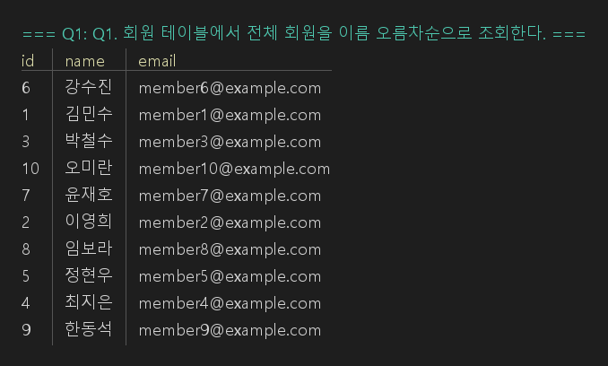 | Q1 실행 결과 | `../Q01.txt` |
| 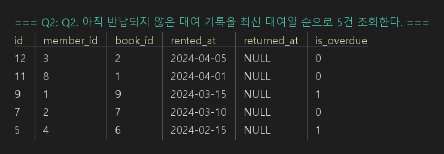 | Q2 실행 결과 | `../Q02.txt` |
| 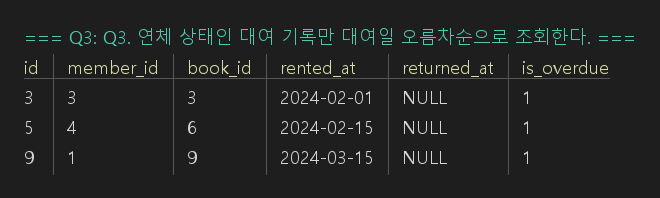 | Q3 실행 결과 | `../Q03.txt` |
| 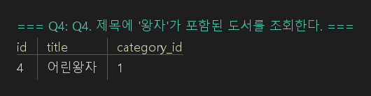 | Q4 실행 결과 | `../Q04.txt` |
| 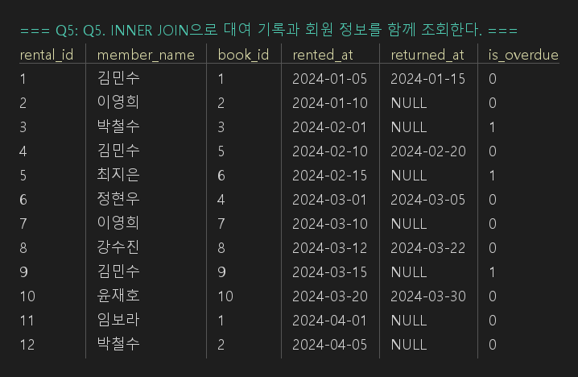 | Q5 실행 결과 | `../Q05.txt` |
| 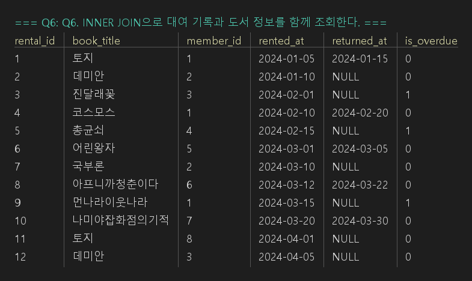 | Q6 실행 결과 | `../Q06.txt` |
| 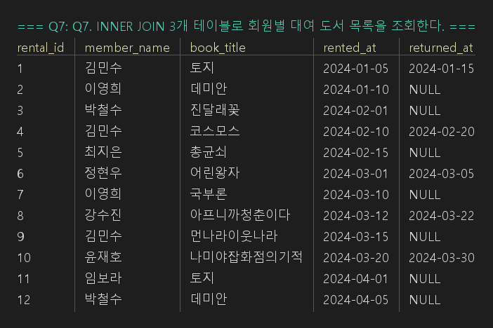 | Q7 실행 결과 | `../Q07.txt` |
| 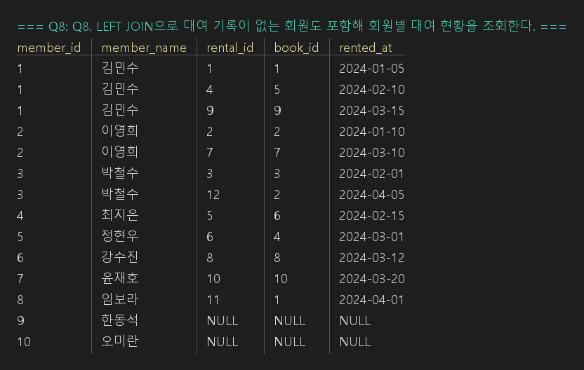 | Q8 실행 결과 | `../Q08.txt` |
| 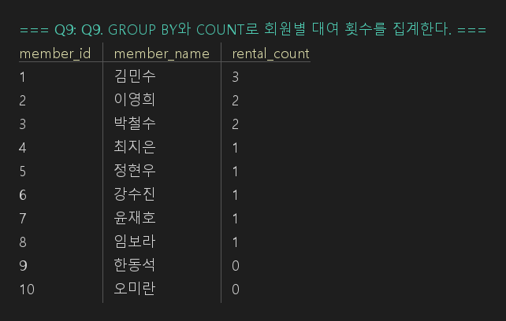 | Q9 실행 결과 | `../Q09.txt` |
| 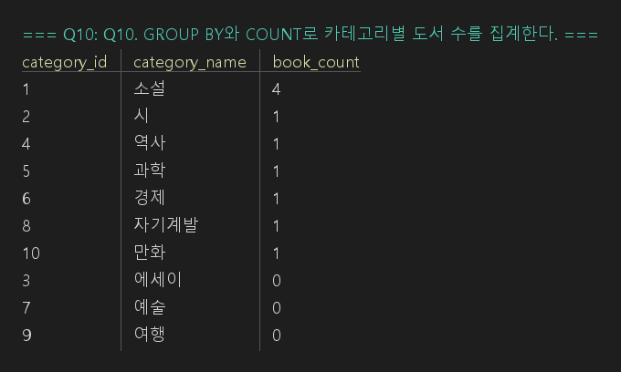 | Q10 실행 결과 | `../Q10.txt` |
| 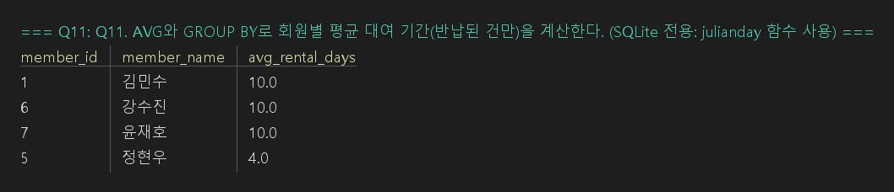 | Q11 실행 결과 | `../Q11.txt` |
| 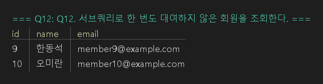 | Q12 실행 결과 | `../Q12.txt` |
| 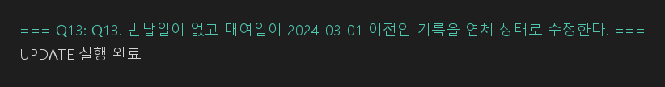 | Q13 실행 결과 | `../Q13.txt` |
| 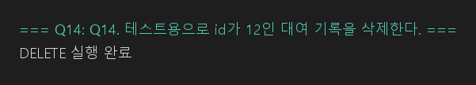 | Q14 실행 결과 | `../Q14.txt` |
| 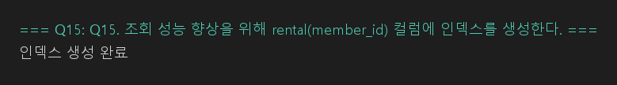 | Q15 실행 결과 | `../Q15.txt` |
| 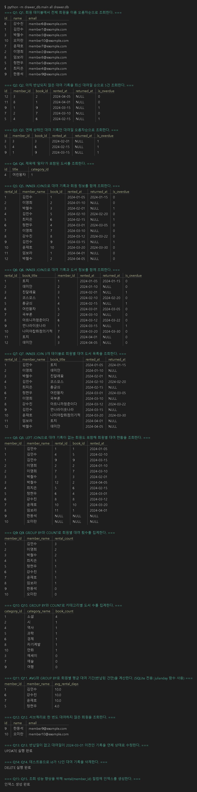 | 전체 실행 출력(`python -m drawer_db.main all`) | `../all_queries.txt` |

## 명령 실행 증거

| 이미지 | 보여주는 것 | 텍스트 원본 |
|---|---|---|
| 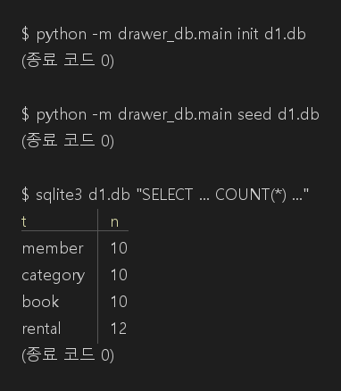 | `init`, `seed` 단독 실행과 테이블별 행 수(10, 10, 10, 12) | `../evidence/01_init_seed.txt` |
| 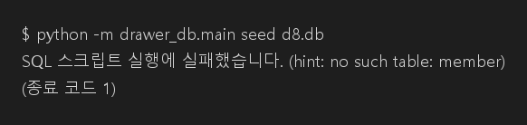 | 스키마 없는 DB 에 `seed` 하면 `no such table: member`, 종료 코드 1 | `../evidence/02_seed_without_schema.txt` |
| 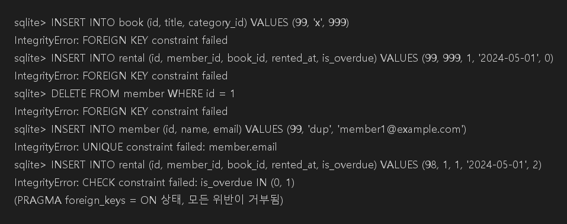 | FK·UNIQUE·CHECK 위반이 `IntegrityError` 로 거부됨 | `../evidence/03_fk_violation.txt` |
| 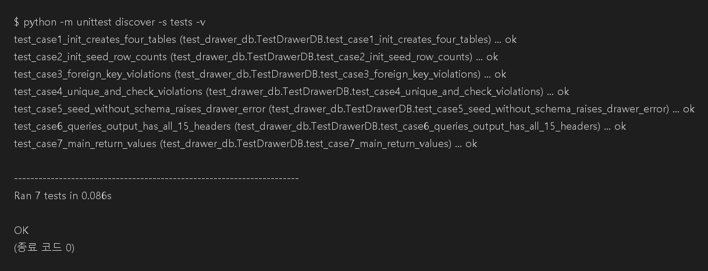 | 자동 시험 7건 통과 | `../evidence/04_unittest.txt` |
| 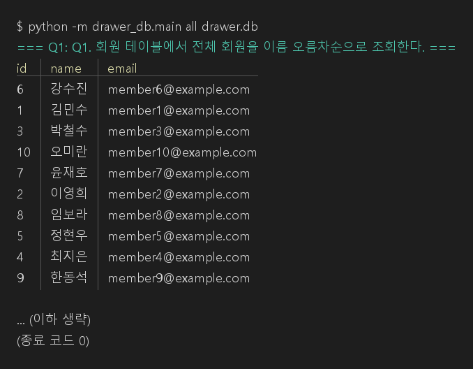 | `all` 실행(앞부분)과 종료 코드 0 | `../evidence/05_all_run.txt` |
| 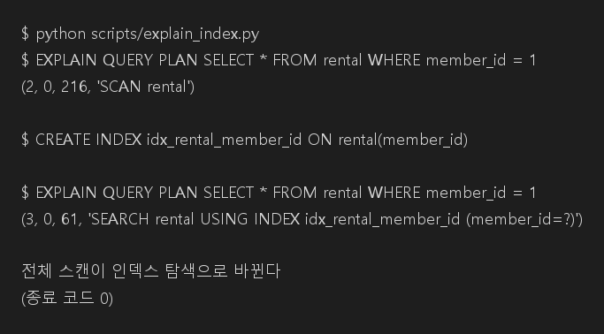 | Q15 인덱스 전후 실행 계획(`SCAN` → `SEARCH ... USING INDEX`) | `../evidence/06_explain_index.txt` |

## 다시 만들기

```bash
python scripts/capture_evidence.py
python scripts/render_captures.py   # Pillow 필요: pip install pillow
```
